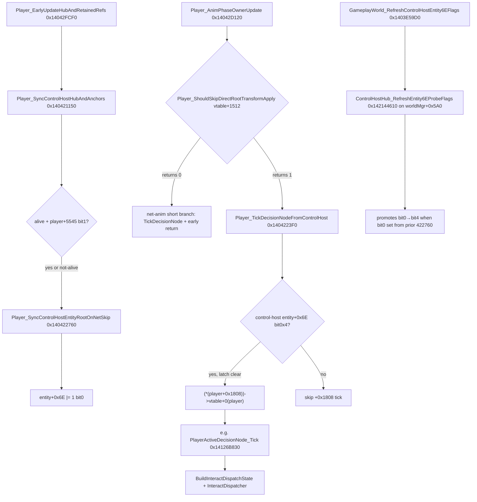

# Player decision-node controllers → interact dispatch (STATIC, 2026-07-10)

## Context

Pickup gesture, aim-pitch, and interact animations on the puppet all hit the same
wall: the retained slot-1 `Player` (joypad 3 / screen 1) is **transform-pinned with
AI off**, so its per-player **decision-node controllers** either do not tick or do
not consume activated interact commands.

Codex mapped the real interact boundary deeper than the HUD pickup queue
(`PlayerWeaponController_EnqueuePickupEvent` / `Hud+0x1930`).

## Interact pipeline (confirmed)

1. **`Player_BuildInteractDispatchState` `0x140C805A0`**
   - Input: `(screenIndex, playerTransform@+0x130)`.
   - Resolves `g_PlayerHandleForHudPublish[screenIndex]`; validates `handle+8` object
     `+0xBC` (188) matches transform identity.
   - Loads `*interact-command-list*`; snapshots per-command active state from
     `InputScreenBlock_IsCommandActive` / `Joypad_IsCommandActive` on the **player's
     joypad index** (`player+0x39B8`).
   - Can call `InputScreenBlock_ActivateCommand` (`0x14183A650`) when command hold
     mode requires it.

2. **`Player_InteractDispatcher` `0x140C85D20`**
   - Consumes the 0x15C-byte block + per-screen dispatcher at
     `0x143EC4EE0 + 0x35C0*screenIndex` (13760-byte stride).
   - Scans `player-pressed-interact-nearby` / hold variants against the built command
     table via `sub_140C88130` (not `+0x518` bitmask).
   - Pickup branch → `Player_StartInteractAction` `0x141C9A360`.

3. **Global gate:** all paths check `!BYTE2(dword_143073DA8)` before dispatch.

## Decision-node controllers that call dispatch (vtable-ticked)

These are **not** called from our hook directly in stock; they are virtual updates on
decision-node objects whose `+0x8` points at the owning `Player`.

| Address | Role (from decompile) | Notes |
|--------|------------------------|-------|
| `0x140EC75D0` | Revive + weapon-pickup disabled-command path | `weapon-pickup-swap` / `weapon-pickup-when-no-weapon`; revive proximity |
| `0x140CD3C00` | Scripted interact controller | `"interact"`, `"script"`, boat-stand-idle; **hardcodes `ResolveScreenRouteEntityByIndex(0)`** for camera child at end |
| `0x140F07DA0` | Mounted / action-family interact | `CheckOwner2E0HashAgainstKnownMountedPlayerActionFamilies` |
| `0x140F70570` | (large) interact + camera route | also ends in dispatch |
| `0x140FC92B0` | (large) interact + camera route | also ends in dispatch |
| `0x141337D40` | Perch / small interact variant | shorter path |
| `0x140D74670` | Compact interact tick | |
| `0x140C88220` | Thin wrapper | only `BuildState` + `InteractDispatcher` |

Full decompile bundle: `reports/full_slot1_controller_decompile.txt`.

## Runtime falsifiers already observed

| Build | Result |
|-------|--------|
| `ActivateCommand` only | `ok=1`, **no animation** — command active, nothing consumes |
| `BuildState → Dispatcher` on puppet | `ok=1 dispatch=0` — command active, **no eligible nearby** |
| Authored `play-simple-gesture` / `play-animation` relay | **REJECTED** — events never fire on ground pickup sender |
| `direct-start` via nearby `WeaponPickup` + `StartInteractAction` | **HYPOTHESIS** in current build; not user-confirmed |

## Nearby-list pipeline (STATIC, 2026-07-10)

Per-screen dispatcher blob layout (`0x143EC4EE0 + 0x35C0*screenIndex`):

| Offset | Field |
|--------|--------|
| `+0` | `int` entry count (max 48) |
| `+8` | 32-byte entries `{handle@0, id@8, interactIndex@16, probeHit@24}` |
| `+0x610` (1552) | per-entry `InputObject` slots, stride 240 |
| `+0x3570` (13680) | `byte` rebuild-request flag (set by `Player_InteractDispatcher` epilog) |

### Frame tick (global, independent of decision-node controllers)

`InteractDispatcher_TickAllScreenBlobs` `0x1401611F0` every frame:

- `InteractDispatcher_TickNearbyList` `0x140C87FB0` on `qword_143EC4EE0` (screen 0)
- in net co-op also on `qword_143EC84A0` (screen 1)

`InteractDispatcher_TickNearbyList`:

1. `InteractDispatcher_PruneNearbyList` `0x140C858F0` — drop stale entries
2. if `dispatcher+0x3570`: `InteractDispatcher_RebuildNearbyList` `0x140C837F0`
3. for valid entries: `NearbyObject_KickProbes` `0x140C82310` (also joypad-gated)

### List rebuild writer

`InteractDispatcher_RebuildNearbyList` `0x140C837F0`:

- `*count = 0`, then spatial gather via `InteractDispatcher_GatherNearbyPlayerObjects`
  `0x141C94340` (+ alternate carry-object / sphere-cast paths in the same function)
- each candidate → `InteractDispatcher_AppendNearbyEntry` `0x140C817F0` → `++count`
- input: dispatch-state block at `dispatcher+0xD04` (3332) — player transform + filters

`Player_InteractDispatcher` sets `dispatcher+0x3570 = 1` at epilog so the **next**
global tick rebuilds the list.

### Joypad gate (leading `dispatch=0` cause)

`InputObject_MatchesActiveLocalJoypad` `0x14023AEA0` compares the linked input
object's joypad index (`object+0x50`) against `g_LocalPlayerInputManager+0x48` or
`+0x50` (which slot depends on flag bits in `object+0x44`). When it returns false:

- `InteractDispatcher_AppendNearbyEntry` leaves `entry+24` (probe hit) at 0
- `NearbyObject_KickProbes` / `InteractDispatcher_UpdateNearbyEntryProbe` skip sphere casts

Puppet uses joypad 3 / screen 1; if that index is not the active local joypad for the
linked input slot, nearby entries exist but **never get probe-hit set** → dispatcher
finds no eligible interactable even when `ActivateCommand` returned `ok=1`.

## Competing hypotheses for `dispatch=0` (updated)

1. **Decision-node never ticks** — alive puppet may skip `422760` when `player+0x15A9`
   bit1 clear (`421150` gate), so hub entity bit0 never set → morning `144610` clears
   bit4 before `TickDecisionNode` (**strongest for missing gesture/anim**; `422760`
   clear via Skill+vtable+96 is REJECTED).
2. **Joypad gate on nearby probes** — list may rebuild but `entry+24` stays 0 because
   `InputObject_MatchesActiveLocalJoypad` rejects joypad 3 (**secondary for
   `dispatch=0` even if node ticked**).
3. **Rebuild gather excludes puppet context** — transform-pinned puppet outside range
   (tertiary).
4. **Built command row inactive** — less likely given `ok=1`.
5. **`BYTE2(dword_143073DA8)`** blocks dispatch globally (unlikely in co-op test).

## Next static targets (before more runtime)

1. **Trace decision-node scheduler** — what vtable owner at `player+0x1F28` (7976) and
   `player+0x1FB0` (8136) tick each frame for local player 0 vs puppet slot 1.
2. **Map `dword_143073DA8` BYTE2** — when set, all interact dispatch is skipped.
3. **Confirm joypad indices** at `g_LocalPlayerInputManager+0x48/+0x50` for screen 0
   vs screen 1 in co-op (falsifies hypothesis 1 if puppet joypad already matches).
4. **Do NOT re-open** HUD pickup queue (`0x1413B49B0`) or authored animation event
   relay — both REJECTED.

## Decision-node scheduler (STATIC, 2026-07-10)

### Player tail-cluster offsets (corrected hex)

| Offset | Dec | Role in scheduler |
|--------|-----|-------------------|
| `+0x1808` | 6152 | **Current decision-node pointer** — `vtable+0(player)` tick |
| `+0x1F28` | 7976 | Interact sub-controller — `vtable+96` in `Active::Update`, `vtable+40` from `EC75D0` |
| `+0x1FB0` | 8112 | **Central dispatch hub** — control-host; entity ref at `hub+16` drives gates |
| `+0x1FC8` | 8136 | Scripted-interact controller (init: `PlayerBoatController` ctor `0x140CD3640`) |
| `+0x1FA0` | 8096 | Mounted sub-controller — `vtable+40` in `Active::Update` |
| `+0x1FE0` | 8160 | Mounted sub-controller — `vtable+40` in `Active::Update` |

Note: `8136` = `+0x1FC8`, **not** `+0x1FB0` (`8112`).

### Per-frame tick order (local player)

**vtable+1512 correction (2026-07-10):** slot +0x5E8 =
`Player_ShouldSkipDirectRootTransformApply` `0x141BC2EF0`. It is **not** a hard
off-switch — **both** branches call `Player_TickDecisionNodeFromControlHost`.
When `Player+0x348 m_pNetController` exists,
`NetController_ShouldSkipAnimPhaseDirectPath` `0x1419136E0` returns skip=1 when
net child `vtable+24` is true.

### Key functions

| Address | Name | Role |
|---------|------|------|
| `0x14042D120` | `Player_AnimPhaseOwnerUpdate` | Anim-phase entry; `vtable+1512` splits branches; both tick decision node from control host |
| `0x141BC2EF0` | `Player_ShouldSkipDirectRootTransformApply` | `vtable+1512` / `+0x5E8`; also root-transform apply predicate |
| `0x1419136E0` | `NetController_ShouldSkipAnimPhaseDirectPath` | Net child `vtable+24` → skip anim-phase direct branch |
| `0x1404223F0` | `Player_TickDecisionNodeFromControlHost` | Syncs from `player+0x1FB0`; `entity+0x6E bit0x4` gates `+0x1808 vtable+0` |
| `0x14126B830` | `PlayerActiveDecisionNode_Tick` | Locomotion decision node; direct `BuildInteractDispatchState → InteractDispatcher` |
| `0x140CD3760` | `Player_DecisionNodePublishGate` | `player+0x1FC8` gate → `PublishRuntimeState` |
| `0x140CA17E0` | `PublishRuntimeStateFromDecisionNodeLikeObject` | `Player::Active::Update` body |
| `0x14042FCF0` | `Player_EarlyUpdateHubAndRetainedRefs` | Early update; calls `421150` |
| `0x140421150` | `Player_SyncControlHostHubAndAnchors` | Hub sync; alive-path `422760` only if `+5545&2` |
| `0x140422BB0` | `Player_PreAnimHubAndAnchorSync` | Sniper aim-pos only; does **not** call `422760` |
| `0x140422760` | `Player_SyncControlHostEntityRootOnNetSkip` | Sets `entity+0x6E bit0` (else); clear via Skill+96 REJECTED |
| `0x1403E59D0` | `GameplayWorld_RefreshControlHostEntity6EFlags` | Global tick; `144610` on worldMgr+0x5A0 (per-player +1FB0 dead for Player) |
| `0x142144610` | `ControlHostHub_RefreshEntity6EProbeFlags` | Sets `entity+0x6E` bits 0x4/0x8 |

### `player+0x1808` lifecycle

| Site | Action |
|------|--------|
| `ConstructOwnerRuntimeClass` `0x141DE181A` | `player+0x1808 = 0` |
| `SetupOwnerRuntimeClassOwnedObject_1728` `0x141DE2604` | `player+0x1808 = player->vtable+0xDE8(player)` |
| `Player vtable +0xDE8` | `Player_ApplyDrawControlUpperHandoffGate` `0x14126C6A0` — void; **open**: actual pointer at runtime |
| Decision-node vtable | `0x142E47BC0` slot+0 = `PlayerActiveDecisionNode_Tick` |

### Puppet wall implication (revised 2026-07-10)

1. **`422760` clear path — REJECTED for Skill at +0x1FF0.** `Skill::vtable+96`
   (`0x140664690`) always returns 1 → `!vtable+96` false → else branch (root sync, `|= bit0`).
2. **Per-player `144610` on `player+0x1FB0` — likely dead.** `Player::vtable+4256`
   (`0x1401D4F10`) always returns 0; gates `GameplayWorld_RefreshControlHostEntity6EFlags` loop.
3. **Frame-order:** bit0 set in `422760` else; bit4 only from `144610` when bit0 set — may lag
   one frame or never promote on puppet hub.
4. **`player+0x1FF0`** = current `Skill*` (not generic state object).
5. **Joypad gate** on nearby probes — `entry+24` may stay 0 for joypad 3.

See `reports/player_1ff0_skill_entity6e_revision.txt`.

`vtable+1512` does **not** alone explain `dispatch=0`. Global nearby-list tick
still runs → `ok=1 dispatch=0`.

### entity+0x6E flag byte (STATIC, 2026-07-10)

Control-host first hub entry `*(player+0x1FB0+16)` — field at `+0x6E` (110 dec):

| Bit | Role |
|-----|------|
| `0x1` | Prerequisite for probe-flag promotion; set by normal root-sync path in `422760` |
| `0x4` | **Gates** `Player_TickDecisionNodeFromControlHost` → `+0x1808 vtable+0` |
| `0x8` | Required with `0x4` for full anim-phase verb continuation (`entity+0x6E & 0xC == 0xC`) |

| Address | Name | Action |
|---------|------|--------|
| `0x142144610` | `ControlHostHub_RefreshEntity6EProbeFlags` | Walk hub+16 array (stride 112); `|= 4`, conditional `|= 8` |
| `0x1403E59D0` | `GameplayWorld_RefreshControlHostEntity6EFlags` | Per-player call from world frame tick |
| `0x140422760` | `Player_SyncControlHostEntityRootOnNetSkip` | Net-skip path: `&= 0xFA` on host entity |
| `0x140422BB0` | `Player_PreAnimHubAndAnchorSync` | Sniper aim-pos only; does **not** call `422760` |
| `0x1401B7500` | `Entity6E_MergeFlagByte` | Generic `&= ~1 \| flags` helper |

Reports: `reports/entity_6e_*.txt`.

## Next static targets

1. **`player+0x1FF0`** — `RefreshOrSelectCurrentStateObject_1FF0` `0x14041F1D0`;
   why puppet has non-null selector + net-skip triplet.
2. **Frame order** — global `3E59D0` set vs anim-phase `422760` clear same frame.
3. **Confirm joypad indices** at `g_LocalPlayerInputManager+0x48/+0x50` (co-op).
4. **Resolve runtime value of `player+0x1808`** — DE8 leaf is void.

## Implication for co-op roadmap

Features that need puppet **gesture / interact / aim-pitch** state machines require
either:

- **A)** Materialize slot-1 as a stock local-player-1 controller (tick the same
  decision-node + interact scan path), or
- **B)** Stay outside the wall: locomotion, cover, weapon display, fire direction,
  grenade button+pose-seed, health, transport — already working or STATIC-ready.
